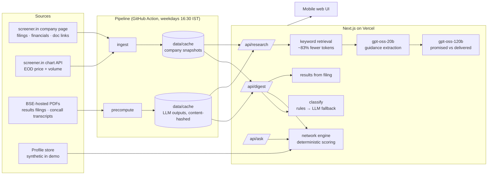

# FINN — Financial Investment Agent

A mobile-first investor copilot that answers three questions in order, every time:

> **What happened → why does it matter → who in my network can explain it?**

FINN watches an 18-stock portfolio, filters the exchange firehose down to the few items that need a decision, and puts the right person from the investor's own network next to each one. On demand, it tears down any NSE company using only primary sources and scores management on **what they promised vs. what they delivered**.

---

## Point of view: how an investor should use this

- **One scroll, ranked by consequence, not time.** "Today" opens with how many things need you, not a feed. Items that could change the thesis (results, M&A, management change, litigation, capex, pledges) get rich cards. "Worth a glance" items get one line. Routine paperwork is collapsed behind a single row.
- **The network is woven in, not a tab you visit.** Every material card ends in *Who can give you context*. Each person comes with the evidence ("Hired him twice — Bharat Forge 2010–14 and Syrma SGS 2018–19") and a one-tap drafted note or intro request. The Network tab exists for direct questions (expertise map, people search), but most of its value shows up inside Push and Pull.
- **You decide what "unusual" means.** Price-move and volume-multiple thresholds and alert categories are user-set. The time window (24h / 3d / 7d / 30d) is one tap away.
- **Compute is explicit.** Numbers render instantly and for free. Reading four transcripts is a deliberate tap ("Analyse management, ~1 min"), cached forever after.

## What's built

| Layer | Working workflows |
|---|---|
| **Push** | Windowed digest across the portfolio (17-category classification → 3-tier priority, routine collapsed, results deduplicated) · configurable EOD alerts (±X% move, N× 20-day volume, 52-week high/low) · **results card** with Revenue / EBITDA / PBT / PAT, QoQ and YoY, extracted from the results filing PDF · **management-change card** with the incoming person's career, education and every overlap with your network · **material-event card** (M&A, capex, litigation) naming the best person to call and why · "reasons to reconnect" nudges |
| **Pull** | Any NSE ticker (try one outside the demo set, e.g. `INFY`) · financial snapshot, 5-year trajectory, balance sheet, cash conversion, working capital, plus rule-based red/green flags · **promised vs delivered**: last 4 concall transcripts → extracted guidance → verdict per promise against reported numbers, credibility score, narrative vs numbers, current guidance, bull/bear, questions to ask · business description · recent filings · source links |
| **Network** | Who should I call (current, former, competitor and theme-expert scoring) · second-degree reach with path strength · diligence on people (overlap inference from career and education, not only explicit links) · expertise map · keeping warm (contacts quiet for 90+ days whose employer just filed news) · "Ask FINN" router for people, themes and companies |

**Portfolio (18):** HDFCBANK, TCS, RELIANCE, BAJFINANCE, ASIANPAINT, TITAN, SUNPHARMA, LT, MARUTI, DIXON, KAYNES, PIIND, DEEPAKNTR, NAVINFLUOR, POLYCAB, TRENT, AAVAS, CHOLAFIN.
**Research set:** PERSISTENT, SRF, CDSL, KPITTECH, CGPOWER. The engine is not tied to these; any NSE symbol works.

## Architecture



### Data pipelines
- **Market data, filings and fundamentals** come from one fetch per company of screener.in: announcements with BSE/NSE links and one-line summaries, standardised quarterly and annual P&L, balance sheet, cash flow, efficiency ratios, peers, and links to annual reports and concall transcripts. The chart API supplies daily close and volume. Fetches are sequential with exponential backoff on 429.
  - I chose this over scraping NSE directly because NSE's API is behind an anti-bot gate. For production I'd use a licensed exchange feed (e.g. NSE/BSE corporate-announcement data products) and keep this as a fallback.
- **Refresh:** `npm run ingest` (daily via GitHub Actions after market close) writes snapshots to `data/cache/`, which is committed. The app reads snapshots first, so it renders instantly and still works when an upstream is down. Ad-hoc tickers are fetched live and cached for 6 hours. On any upstream failure the last good copy is served.
- **Primary documents:** PDFs are downloaded, converted to text with `unpdf`, and cached by URL.
  - **Concall transcripts:** keyword-window retrieval keeps only forward-looking, number-bearing passages before any model sees them (15.7K → 2.7K tokens on a Dixon transcript).
  - **Results filings:** sliced to the statement pages.
- **Entity linking:**
  - **Filings → people:** names are extracted from filing titles with a regex, and with an LLM only if no "Mr./Ms." name is present. They resolve to the profile store by full-name match only: FINN never guesses an identity. Unresolved names are shown as unresolved.
  - **People → companies:** employers resolve to NSE symbols via an org-to-symbol map, which links a person's history to holdings and to Screener's peer lists (competitor matching).
  - **Overlap inference:** same employer with overlapping years means *worked with*; same school within ±2 years means *studied with*; explicit edges mean *knows*, with a strength from 0 to 1.

### LLMs and agents: where a model is (and isn't) used
| Step | How | Why |
|---|---|---|
| Announcement classification | Regex rules on formulaic exchange titles; **gpt-oss-20b** only for leftovers, batched | Rules are free, instant and auditable, and cover most filings |
| Priority / materiality | Rules (category + keyword promotion/demotion) | Must be predictable; the user tunes alert categories |
| Results numbers | **gpt-oss-20b** extracts raw lines from the filing; EBITDA = PBT + finance cost + D&A − other income is computed in code | The model copies numbers; it never does arithmetic. Falls back to standardised data, flagged if stale |
| Name extraction from filings | Regex → **gpt-oss-20b** fallback | Tiny inputs |
| Guidance extraction (per transcript) | **gpt-oss-20b**, strict JSON schema, retrieved passages only | Bulk reading is cheap work |
| Promised vs delivered, bull/bear | **gpt-oss-120b**, strict JSON schema | The one step that needs real judgement |
| Who to call, paths, overlaps, nudges | **No model.** Deterministic scoring with evidence strings | Must be verifiable; a model here only adds hallucination risk |
| "Ask FINN" | **No model.** Intent router over the investor's own universe | Instant, free, can't invent a person or a company |

- **Provider and models.** Groq free tier (OpenAI-compatible, strict JSON-schema outputs). `qwen/qwen3.8-27b` is the automatic fallback when a model is rate-limited.
- **No autonomous agent.** This is a fixed workflow: retrieve → extract → judge. Each step is cheap, cached and inspectable; an open-ended agent loop would add cost and unpredictability for no gain on this task.
- **Grounding.** Pull prompts receive only transcript passages and reported numbers, and are instructed to use nothing else (no news, no broker notes, no world knowledge). Every promise cites the call it came from; sources are linked on the page.
- **Cost controls:**
  - Content-hash caching of every LLM output (90 days), committed for the demo set, so a reviewer opening the app triggers **zero** model calls.
  - Prompt versions are part of the cache key.
  - Retrieval before extraction.
  - Small model for bulk work, large model once per company.
  - Explicit user action for the expensive path.

### Data security and privacy (for a real deployment)
- **The network is the investor's private data.**
  - Single-tenant storage, partitioned per investor and encrypted at rest with a per-tenant key (KMS).
  - Never pooled across users and never used for training.
  - Second-degree links come only from what contacts have explicitly shared or consented to, never from scraping their connections.
- **What's stored:** professional facts only (employers, roles, tenure, education, expertise tags) plus the investor's own relationship notes. No contact details beyond what the investor enters, and no personal or sensitive attributes.
  - Public-profile enrichment is cached for at most 90 days, then re-fetched or dropped.
  - A person removed by the investor is hard-deleted along with their derived edges.
- **Consent:**
  - Profile data comes from a licensed, ToS-compliant provider or from the contact's own opt-in (e.g. a "share my profile with X" link). It is never scraped from LinkedIn.
  - People named in filings are public-record company officers; their profiles are enriched under the same rules.
- **Access control:** SSO + MFA, row-level security keyed on tenant, audit log of every network query.
- **LLM boundary:**
  - Only company documents are sent to model providers. Network data never leaves the app's own compute: the network engine is deterministic for exactly this reason.
  - If a model were ever needed on network data, it would be a self-hosted open model (e.g. Qwen on a private GPU) or a zero-data-retention endpoint.
- **This demo:** all people are **synthetic** (`src/data/network.ts`, labelled in the UI); employers are real listed companies so the overlaps are meaningful. Five clearly labelled **scenario** filings (toggle in Settings) demonstrate the management-change, M&A, USFDA and capex flows. Everything else is live data.

### Cloud: what runs where
- **Vercel** runs the Next.js UI and API routes (serverless). Research streams progress over NDJSON with a 300-second limit.
- **GitHub Actions** runs the daily ingest + precompute. Committing to `data/cache` triggers a redeploy, which gives a zero-ops pipeline on free tiers.
- **Groq** handles LLM inference (free tier).
- **Production:** I'd move snapshots to Postgres (filings, financials) plus object storage (PDF text), the network to an encrypted per-tenant store, and ingest to a scheduled worker with an exchange feed, and push alerts via Web Push or WhatsApp.

## What I deliberately left out
- Real-time intraday data (the brief is EOD), and push notifications. The digest and alerts are computed; delivery is the next step.
- An LLM chat box. A typed router answers the four common question shapes instantly; a free-form agent is the wrong first tool.
- Annual-report deep reads. ARs are linked; transcripts carry the guidance needed for promised-vs-delivered, at a tenth of the tokens.
- Real LinkedIn data (terms of use). The profile layer is synthetic, with the production approach described above.

## Next steps
1. Delivery: Web Push / WhatsApp for alerts, and a 7:30am digest.
2. Network ingestion: import contacts (CSV, vCard, email-signature parsing) plus consented enrichment, and let the investor log calls so "last spoke" maintains itself.
3. Promise ledger: persist each guidance statement and re-score it automatically when the next quarter's results file.
4. Peer-relative research: run promised-vs-delivered across a sector and rank managements on credibility.

## Run it

```bash
npm install
cp .env.example .env.local     # add a free GROQ_API_KEY from console.groq.com
npm run ingest                 # refresh snapshots (optional; committed copies exist)
npm run precompute             # optional: precompute LLM analyses for the demo set
npm run dev
```

Without a key, everything except transcript analysis and filing-PDF extraction works; results then fall back to standardised numbers, with a staleness note.
